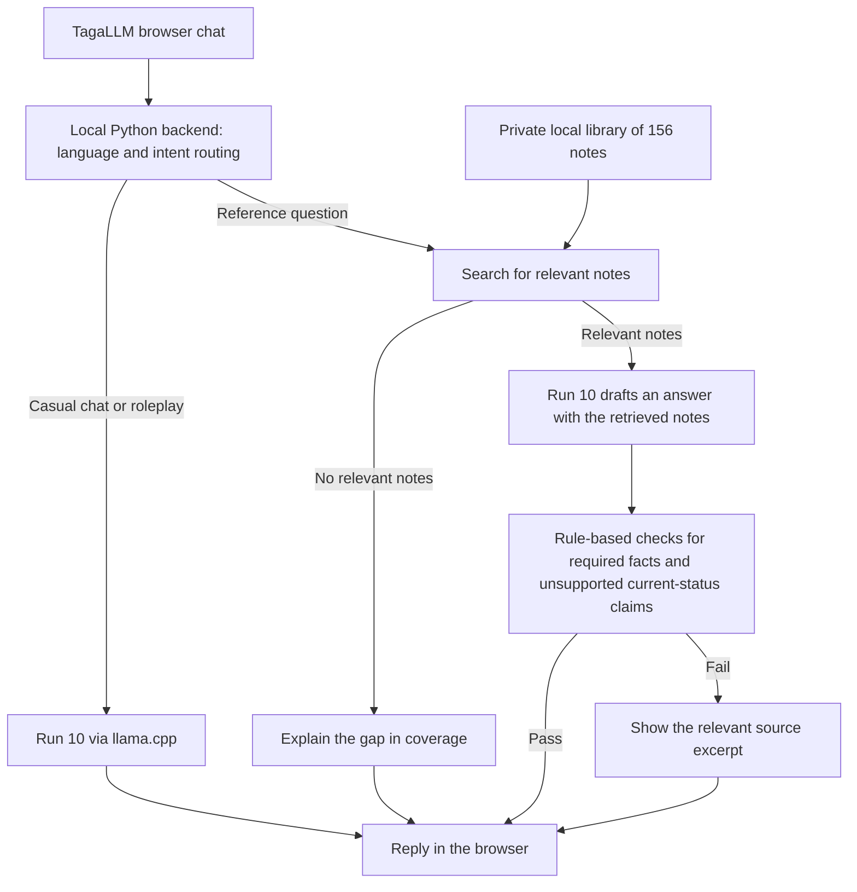

# TagaLLM

TagaLLM is a research project and chat application for everyday Metro Manila Tagalog and Taglish. It explores how models handle short conversations about daily life and keep track of changes to people, places, and plans.

The project started with small Transformers trained from scratch and custom tokenizers. The original local demo uses Google Gemma 4 E2B in Q4_K_M with a Tagalog system prompt, curated cultural references, and a separate SEA-LION classifier for language and scope checks. The demo uses base Gemma weights. The culture LoRA pilot was a separate experiment.

[Open the visual preview](https://joshuabrew.github.io/TagaLLM/) · [Read the research article](https://joshuabrew.github.io/TagaLLM/article.html) · [See downloads](https://joshuabrew.github.io/TagaLLM/downloads.html)

## What's new in Run 10

Run 10 is the default checkpoint in the newer local research app. It builds on the Run 9 adapter for Gemma 4 E2B IT and was evaluated with a library of 156 Philippine reference notes. With lookup disabled, both runs answered 4 of 12 questions fully correctly. With the right notes, Run 10 gave clearer or more complete answers in some cases.

[Read the Run 10 research article](https://joshuabrew.github.io/TagaLLM/run-10.html) for the training details, loss charts, and side-by-side replies. See the [Run 10 setup instructions](docs/run-10-install.md) for the Windows launcher and required files. The existing local installation guide below covers the original Gemma demo.

## Run 10 architecture

[Read the architecture and design decisions](docs/run-10-architecture.md).

The local Python backend combines a LoRA-fine-tuned Gemma 4 E2B IT checkpoint with retrieval-augmented generation (RAG). It runs the merged Q4_K_M GGUF through llama.cpp. For reference questions, the backend uses text and keyword matching over a private library of 156 Philippine notes.

Hugging Face hosts the checkpoint. GitHub hosts the app and launcher. The reference library stays local, and the launcher reads it from the path passed to `-SourceLibrary`. [Model download](https://huggingface.co/JoshBrew/TagaLLM-Run-10) · [Run 10 setup](docs/run-10-install.md)

## Run it locally

**The GitHub Pages demo is a visual preview only.** GitHub Pages serves the interface without a model backend, so the public demo cannot generate replies. To chat with Gemma, [download the GitHub ZIP](https://github.com/JoshuaBrew/TagaLLM/archive/refs/heads/main.zip) (or clone this repository) and follow the [local installation guide](docs/install.md#run-the-local-chatbot). The ZIP includes the same chat UI, saved-chat sidebar, and local server code. Download the Gemma weights separately as described in the guide. The research evaluation used additional SEA-LION language and scope checks. The [installation guide](docs/install.md) covers model downloads, dependencies, and startup commands.

## Repository layout

| Location | Contents |
| --- | --- |
| Root HTML pages | Public entry points for the chat preview, research article, evidence, model card, and downloads. |
| [assets/css/](assets/css/) | Shared styles for the demos and research pages. |
| [assets/images/](assets/images/) | Demo artwork and the tokenizer comparison chart. |
| [assets/js/](assets/js/) | Chat interface, conversation history, and inference settings. |
| [docs/](docs/) | Research articles, architecture notes, and installation guides. |
| [local/](local/) | Local web server, chat backend, system prompt, and cultural references. |
| [tokenizers/](tokenizers/) | The original 2K byte-level BPE and the 4K research tokenizer for the scratch models. Gemma uses its own tokenizer. |

## Models and dataset

The [TagaLLM collection](https://huggingface.co/collections/JoshBrew/tagallm-6af280345e2e4ff6235630ea) groups the four model repositories and dataset card in one place. GitHub contains the application code, setup instructions, and research write-up. Hugging Face contains the downloadable model weights and their cards.

- [Gemma 4 E2B Q4_K_M](https://huggingface.co/JoshBrew/TagaLLM-Gemma-4-E2B) for the local demo.
- [TagaLLM 3.75M](https://huggingface.co/JoshBrew/TagaLLM-3.75M-256) and [TagaLLM 15.5M](https://huggingface.co/JoshBrew/TagaLLM-15.5M-256) with 256-token contexts.
- [TagaLLM 15.52M](https://huggingface.co/JoshBrew/TagaLLM-15.52M-512) with a 512-token context.

The [Hugging Face dataset repository](https://huggingface.co/datasets/JoshBrew/TagaLLM-Dataset) currently publishes the dataset card and aggregate counts for the redacted candidate. A native Tagalog speaker reviewed selected dataset examples for grammatical accuracy, natural phrasing, and fit with everyday Metro Manila Tagalog. The [research evidence](https://joshuabrew.github.io/TagaLLM/evidence.html#frozen-splits) documents the separately pinned snapshots used for the experiments.

## Human-in-the-loop review

A native Tagalog-speaking tutor provided feedback on grammar, phrasing, naturalness, and cultural context in everyday Tagalog and Taglish. The tutor also reviewed model-generated conversations and suggested corrections.

The tutor's review was qualitative and unscored. The development evaluation below reports the quantitative results.

## Evaluation

In the 20-chat development evaluation, the local Gemma app earned full naturalness marks on 110 of 120 replies and full relevance marks on 67 of 120. It passed 37 of 72 scored state-tracking checks, and three conversations passed all six exchanges. The median reply time on the test machine was 2.16 seconds.

These are results for the local app with prompts and cultural references. See the [model card](https://joshuabrew.github.io/TagaLLM/model-card.html) and [evaluation evidence](https://joshuabrew.github.io/TagaLLM/evidence.html) for the scoring criteria, limitations, and experimental comparisons.
