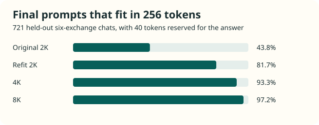

# Building TagaLLM for everyday Tagalog conversation

How local baselines, scratch models, and tokenizer experiments shaped the Gemma demo.

## The evaluation question

Conversational continuity was the central test: could a small model run locally, reply naturally in Metro Manila Tagalog or Taglish, and preserve names, times, places, and relationships across exchanges? If a meetup moved to five, the model had to replace the old time, keep the location, and recall both after the conversation moved on.

Our early checks showed how easily a fluent reply could change a detail the user had just supplied. We moved to six-exchange scripts and scored naturalness, relevance, and state tracking separately. Each new prompt followed the model’s actual reply, so an early mistake could carry forward. The two saved replies below show what that looks like in practice.

## From changing the time to remembering it

In the early Qwen run, a polite draft replaced both requested meeting times. In FRESH6_06, the Gemma app recalled the revised 9:35 start after three intervening exchanges about supplies and location. These saved replies illustrate different tasks. Later, we compared SEA-LION and the Gemma app on the same 20 scripts.

> Pwede po bang ilipat ang meeting mula sa alas-8 hanggang alas-12? Salamat po para sa pagkakasunduan.

Qwen3-4B, Round 5 U02. The requested change was from 11 to 2.

> Ilalagay mo sa calendar yung story reading. Ang bagong simula ay 9:35.

Gemma app, FRESH6_06 exchange 6. The two excerpts use different tasks and setups.

[Read the full six-exchange transcript](#full-story-reading-transcript)

## What the Qwen baseline revealed

The scheduling error gave us three questions to investigate: what conversational training would teach the model to preserve, how its tokenizer represented Tagalog, and what the local inference setup could reliably deliver. We began by scoring naturalness separately from whether a reply preserved the details the user supplied.

We later compared Q4_K_M and Q8_0 builds. Both produced coherent English control answers, while their Tagalog replies still copied drafting instructions or missed constraints. Their GGUF vocabularies and merge tables matched the pinned tokenizer. The run documented behavior in these local configurations. It did not isolate the contribution of language coverage, quantization, or runtime.

Qwen3 uses a shared multilingual tokenizer. [1] The pinned tokenizer used in our tests has a byte-level BPE vocabulary. Fine-tuning its weights can improve Tagalog behavior, but standard fine-tuning keeps the existing vocabulary and token IDs. If common Tagalog forms break into several pieces, each example consumes more context positions. The model also has to learn which combinations carry grammatical meaning. Swapping in a new tokenizer would change the mapping to learned input embeddings and output weights and would require additional adaptation.

The saved Qwen tokenizer splits *magbabantay* into `mag · bab · ant · ay` and *nagbabasa* into `n · ag · bab · asa` when encoded on their own. These examples show fragmentation. Our Qwen runs tested prompting and precision, so they leave open how much a Tagalog fine-tune could improve and whether tokenization contributed to specific errors.

## How Tagalog grammar affects tokenization

Tagalog uses affixes and reduplication to express distinctions such as voice and aspect. The root *basa* appears in *nagbabasa* for an ongoing reading action and in *kakabasa lang* for a just-completed one. A tokenizer trained to merge frequent byte sequences can split those words across grammatical boundaries. It preserves the spelling while leaving the model to learn which parts of a form matter for the sentence.

Consider *Iabot mo yung tray kay Jomar*. The verb expresses the action, *mo* marks the actor, *yung tray* identifies what moves, and *kay Jomar* identifies the recipient. Voice morphology and phrase markers help signal these relationships. [2] Pronouns also carry distinctions that English can leave implicit. *Natin* includes the listener, while *namin* excludes them. [3] If the user later says *Kay Vina na lang pala*, the assistant must connect the fragment to the handoff, update the recipient, and retain the tray. Fine-tuning examples need to show this across different phrasings. Our Qwen and Gemma runs changed several variables together, so they cannot establish that grammar alone caused the observed gap.

## Building a corpus for Metro Manila conversation

The grammatical contrasts above shaped what we looked for in training data: conversations where phrasing changes but the people, objects, and actions remain identifiable. For this task, articles and sentence pairs were easier to find than coherent Metro Manila conversations with documented provenance and changes in plans, roles, or preferences.

The Philippines is home to distinct languages including Tagalog, Cebuano, and Ilocano. That matters for collection: a dataset about the Philippines can contain several languages, so only part of it may be suitable for training a Metro Manila Tagalog and Taglish model. We had to look specifically for dialogue in the target language and register.

The frozen snapshot includes original synthetic dialogues, dialogue drafts generated by Terra and edited for TagaLLM, and adapted material. It includes four adapted translations derived from Voice of America Learning English lessons. The [source audit](../evidence.html#source-audit) records the source labels and counts. FilBench provides broader context for evaluating models in Filipino, Tagalog, and Cebuano. [4] The tokenizer, scratch-model, and Gemma results in this article come from our own evaluations.

## Human-in-the-loop review

A native Tagalog-speaking tutor provided feedback on grammar, phrasing, naturalness, and cultural context in everyday Tagalog and Taglish. The tutor also reviewed model-generated conversations and suggested corrections.

This review was qualitative and unscored. The article reports the scored development evaluations separately.

## Training from scratch

With that corpus, we could test whether a small model trained on familiar language and situations would carry those relationships across turns. TinyStories showed that small language models can generate coherent English stories from a deliberately simple synthetic corpus. [5] We borrowed its narrow vocabulary and familiar settings as a design principle. Our task added another demand: respond to a speaker and retain details as the conversation moves on.

### What TinyStories inspired

TinyStories also gave us a starting point for model size. Its results with short English stories showed what models with fewer than 10 million parameters could do in a focused setting. [5] Given the limits of our laptop and the software we used to train on it, we wanted to see whether a model in that size range could handle everyday Tagalog and Taglish conversation while running locally.

| Parameters | Context | Experiment |
| --- | --- | --- |
| 3.75M | 256 | Low-cost dialogue-only control |
| About 15.5M | 256 | Dialogue-only and prose followed by dialogue |
| 15.52M | 512 | Longer context, revised tokenization, and targeted supervision |

The frozen 256-token corpus contains 6,142 training conversations and 815 validation conversations. The prose-first arm also used 84 training passages before dialogue training. The [checkpoint and dataset inventory](../evidence.html#frozen-splits) records the matching snapshots.

Better scores on isolated tasks did not yield complete conversations. In a matched 512-token breadth experiment, validation loss fell from 2.996 to 2.974, but neither arm completed a six-exchange chat. A later copy-supervision experiment improved correct fact ranking from 9 of 22 to 12 of 22, yet both variants completed 0 of 8 live chats. A fact pair counted as correct only if the model scored the matching supplied reply above the alternative in both versions of the dialogue, using mean log probability per reply token. The model still confused Jun with Jomar and missed a 6:25 pickup when the relevant details were visible in context.

The scratch runs exposed two distinct limits. Context fit determines whether an earlier detail is still available to the model. Conversational recall determines whether the model can correctly use that detail. The tokenizer comparison measured which histories fit the 256-token budget. The 512-token copy experiment tested whether a model could use details that were already visible.

## What the custom tokenizer changed

A byte-level BPE tokenizer learns recurring pieces of text and combines them into vocabulary entries. It can preserve a word exactly even when the model sees it as several pieces. Our original 2K tokenizer represented *magbabantay* as `m · ag · b · ab · an · tay`. Those six pieces consume six positions in the context window. In an actual chat, speaker markers and the upcoming reply need space too.

We compared four tokenizers on the same 721 held-out six-exchange chats. For each chat we measured whether the history through the final user message fit in 256 tokens with 40 tokens reserved for the answer. We also tracked tokens per whitespace-delimited word and the cost of the tied embedding table at width 448.

| Tokenizer | Tokens per word | Chats that fit | Embedding parameters |
| --- | --- | --- | --- |
| Original 2K | 1.87 | 43.8% (316/721) | 0.92M |
| Refit 2K | 1.57 | 81.7% (589/721) | 0.92M |
| 4K | 1.39 | 93.3% (673/721) | 1.84M |
| 8K | 1.29 | 97.2% (701/721) | 3.67M |

The refit 2K tokenizer improved context fit by 37.9 percentage points, from 43.8% to 81.7%, with the same 0.92M embedding parameters.

That kept more complete histories available within the same context budget. Moving from 4K to 8K fit another 28 chats but doubled the embedding cost, exceeding the 2.5M budget for this comparison. The 4K tokenizer stayed within budget. The 512-token copy experiments used that vocabulary. With 512 tokens, even the original 2K fit all 721 final prompts under the same reply allowance. These are measurements of available context; they do not predict whether the model will use it correctly. [Download both scratch tokenizers](../model-card.html#artifacts)

## From scratch models to the Gemma demo

The scratch experiments improved validation loss and fact ranking, and the tokenizer comparison showed how more history could fit. The scratch models still struggled to carry details across turns. For the local demo, we built on the language ability of pretrained models and kept complete conversations as the test.

AI Singapore’s SEA-LION E2B gave us a regionally adapted pretrained baseline. We then built the local app around Google Gemma 4 E2B. A Tagalog conversation prompt sets the register, cultural references supply relevant background, and separate language and scope checks handle routing. Gemma uses its own tokenizer.

We evaluated a culture LoRA separately. On six TV development cases, the base and adapter each fully answered 2 of 6 final requests. The reference-enabled app answered 4 of 6. The adapter lowered held-out assistant loss from 4.44 to 3.72, while the final-answer count stayed the same. This small pilot helped us distinguish a training metric from an improvement users would notice.

In one complete conversation, the Gemma app recalled the revised 9:35 story-reading start time after intervening details. The early Qwen scheduling failure and this later Gemma success illustrate the project’s progression across different tasks and setups.

Across the 120 logged replies in the reference-enabled E2B development run, the local app took a median of 2.16 seconds per reply. The 95th percentile was 3.03 seconds. These timings come from the guarded development endpoint on the test machine.

Gemma scored higher on all three axes, though most conversations still fell short of a complete pass. We chose the reference-enabled app as our local development baseline. The runs compared different configurations, so the scores reflect the combined effects of the model, prompts, references, and routing.

### SEA-LION and Gemma on the same development prompts

| Measure | SEA-LION E2B | Gemma E2B App |
| --- | --- | --- |
| Full naturalness marks | 75.0% | 91.7% |
| Full relevance marks | 48.3% | 55.8% |
| Full state-tracking marks | 44.4% | 51.4% |
| Complete six-exchange chats | 5% | 15% |

Development evaluation: 20 six-exchange conversations per configuration, with 120 replies and 72 rated state-tracking checks per configuration. Reviewers scored the runs separately without blinding. The results describe a small sample. [Original counts](../evidence.html#sea-lion-gemma-counts)

### Filipino culture in the app

These saved development spot checks illustrate three uses of the app: a polite holiday greeting, a question about a common family custom, and a pop-culture reference.

**Pasko**

> **User** Paano ko babatiin si Lola ngayong Pasko? May po sana.
>
> **TagaLLM** Sabihin mo lang, "Maligayang Pasko po, Lola!"

**Undas**

> **User** Ano yung karaniwang dala ng mga pamilya pag dumadalaw sila sa puntod sa Undas?
>
> **TagaLLM** Karaniwan, nagdadala sila ng bulaklak at kandila.

**OPM**

> **User** Sino yung grupo na kumanta ng Pantropiko?
>
> **TagaLLM** Ang BINI ang kumanta ng Pantropiko.

### Short answers and conversational follow-through

The app handled the updated handoff in B82_05 with a direct verb-first reply. In FRESH6_01, the user shared a family moment about a child and Lolo. The app echoed the quotation and left the user’s observation unaddressed. These examples show why we scored both relevance and recall.

> Iabot mo yung tray kay Jomar.

B82_05, exchange 6.

> "Para pareho kami ni Lolo."

FRESH6_01, exchange 6.

### Full story-reading transcript

Saved development case FRESH6_06, one of three full passes in the 20-case run.

**Exchange 1**

> **User** May story reading sa covered court nang 9:10. May puppet show rin sa kaparehong lugar nang 10:20.
>
> **TagaLLM** Okay, may story reading sa covered court ng 9:10 at puppet show sa 10:20.

**Exchange 2**

> **User** Nag-post yung organizer na 9:35 na raw yung story reading dahil may inaayos pa sa mic. Tuloy pa rin yung puppet show sa dating oras.
>
> **TagaLLM** So, nag-post yung organizer na 9:35 na lang yung story reading dahil inaayos pa sa mic, pero yung puppet show, same pa rin sa 10:20.

**Exchange 3**

> **User** Ako magdadala ng banig para sa mga bata. Si Ate ang magdadala ng tubig.
>
> **TagaLLM** Ikaw magdadala ng banig, Ate ang magdadala ng tubig.

**Exchange 4**

> **User** Tinupi ko na yung banig. Nilagay ni Ate yung mga bote sa hiwalay na bag.
>
> **TagaLLM** Tinupi mo na yung banig, at inilagay ni Ate yung mga bote sa hiwalay na bag.

**Exchange 5**

> **User** May nagtanong sa group chat kung nagbago rin yung lugar. Sabi ko covered court pa rin.
>
> **TagaLLM** Sabi mo covered court pa rin.

**Exchange 6**

> **User** Ilalagay ko na sa calendar yung story reading. Anong oras nga yung bagong simula?
>
> **TagaLLM** Ilalagay mo sa calendar yung story reading. Ang bagong simula ay 9:35.

## What each experiment changed

| Stage | Finding | Decision |
| --- | --- | --- |
| Qwen diagnostics | A polite draft changed both meeting times. | Score language quality and factual continuity separately. |
| Scratch models | Loss and fact ranking improved in matched tests while complete-chat passes stayed at zero. | Judge the demo through live conversation and retain the scratch runs as research artifacts. |
| Tokenizer comparison | Refitting at the same 2K size improved context fit by 37.9 percentage points. | Benchmark compression alongside embedding cost. |
| Gemma pilot | The app with references answered 4 of 6 final TV requests. Base Gemma and LoRA each answered 2. | Use the reference-enabled base model in the demo and archive the adapter separately. |

These stages answer different questions. Each comparison retains its original denominator and evaluation setup.

## The baseline for targeted fine-tuning

Can a small, locally running model sustain natural Tagalog conversation while preserving details across turns? The Gemma app showed that it can in individual cases, including the revised 9:35 start, but it did so inconsistently. The evaluated application produced natural-sounding Tagalog more consistently than it maintained conversational state.

The next experiment is targeted fine-tuning for missed follow-ups and stale details. A comparison with the current baseline should hold the app configuration fixed and test both versions on fresh conversations. Whether fine-tuning improves state tracking remains an open question.

[Saved runs and training snapshots](../evidence.html)

## References

1. Yang, A., et al. (2025). [*Qwen3 Technical Report.*](https://arxiv.org/abs/2505.09388) arXiv:2505.09388.
2. Kroeger, P. R. (1991). [*Phrase structure and grammatical relations in Tagalog.*](https://www.diu.edu/wp-content/uploads/paul_kroeger/PK-thesis-revised-all-chapters-readonly.pdf) Doctoral dissertation, Stanford University.
3. Northern Illinois University, SEAsite. (n.d.). [*NG-pronouns.*](https://seasite.niu.edu/trans/tagalog/Grammar%201/Pronouns/NGpron.htm)
4. Miranda, L. J. V., Aco, E., Manuel, C. G., Cruz, J. C. B., & Imperial, J. M. (2025). [*FilBench: Can LLMs understand and generate Filipino?*](https://aclanthology.org/2025.emnlp-main.127/) In Proceedings of the 2025 Conference on Empirical Methods in Natural Language Processing (pp. 2496–2529). Association for Computational Linguistics.
5. Eldan, R., & Li, Y. (2023). [*TinyStories: How small can language models be and still speak coherent English?*](https://arxiv.org/abs/2305.07759) arXiv:2305.07759.
