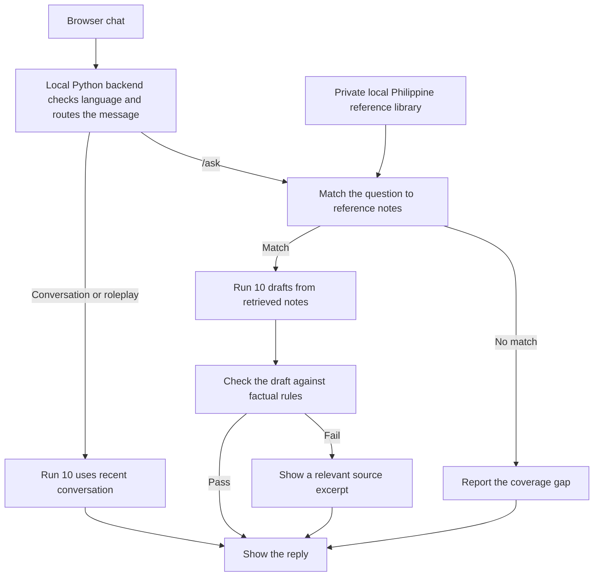

# TagaLLM Run 10 architecture

Run 10 serves two purposes in one local app. It supports everyday Tagalog and Taglish conversation and answers reference questions about Philippine history, news, and public affairs. These tasks need different inputs. Conversation depends on recent turns. A question about a historical event or a dated news report also needs relevant evidence.

## Why combine fine-tuning with retrieval?

Run 10 is a Gemma 4 E2B IT checkpoint with a merged LoRA adapter, served locally through llama.cpp as a Q4_K_M GGUF. Fine-tuning adapts how the model responds in Tagalog and Taglish and how it writes from supplied context. The reference library gives the app a way to provide specific dates, names, and figures at answer time. This matters for a compact model whose recall of exact details can be unreliable. Keeping reference notes in a separate file also lets us update coverage without retraining or shipping a new checkpoint.

## How a message moves through the app

In the browser, ordinary messages go through the conversation route. Use `/ask` for reference lookup. The backend searches the local notes using text and keyword matching and adds the relevant material to the model's prompt. A source follow-up can identify the notes used for the preceding reference question.

The factual checks look for specific problems, such as omitted required numbers or unsupported claims about current status. A dated news note can support what was reported at the time. A claim about what is true today needs evidence that covers the present. If a draft fails a check, the app can show the relevant source excerpt directly. The checks cover defined failure cases. They do not independently verify every claim in an answer.

## Where each part runs

The browser interface, Python backend, reference lookup, and llama.cpp inference run on the user's machine. GitHub hosts the code and launcher. Hugging Face hosts the Run 10 checkpoint. The 156-note reference library is loaded from a local file supplied at launch. [Windows setup](run-10-install.md) · [Run 10 checkpoint](https://huggingface.co/JoshBrew/TagaLLM-Run-10)
